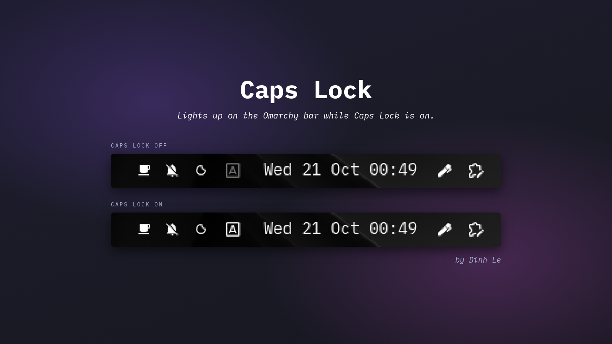

# Caps Lock for Omarchy



A minimal Omarchy bar widget that shows whether Caps Lock is on. The icon lights up while Caps Lock is on and stays dim while it is off.

## Install

```sh
omarchy plugin add https://github.com/lnhdb/omarchy-capslock --enable
```

To update it to the latest version:

```sh
omarchy plugin update lnhdb.capslock
```

To remove it:

```sh
omarchy plugin remove lnhdb.capslock
```

## How it works

Hyprland sends no event when Caps Lock changes, so the widget runs `hyprctl -j devices` every 200 ms. The boxed A icon on the bar lights up when any keyboard reports Caps Lock.

## License

MIT. See [LICENSE](LICENSE).
